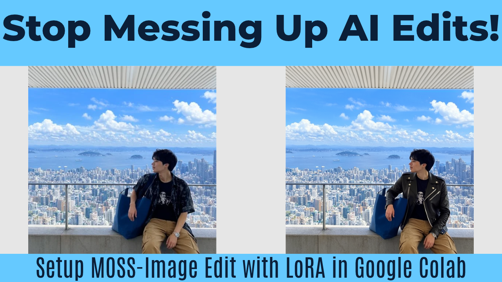

# ⚡ MOSS-Image T2I & Edit in Google Colab

This repository contains a simple, automated Google Colab notebook for running the **MOSS-Image** AI model. Built on a ComfyUI backend, it allows you to generate stunning images from text (Text-to-Image) and perform precise edits on existing photos (Image-to-Image), completely free on a Google Colab T4 GPU.

**🎥 Watch the Tutorial:** [How to Use](https://www.youtube.com/watch?v=soon)

**🚀 Run in Colab:** [Open Google Colab Notebook](https://colab.research.google.com/drive/1Zw1a7MKYIvUw_IXIhcYwc6VDue8bn_z4?usp=sharing)

---

## ✨ Features Supported in this Notebook

This notebook automates the MOSS-Image workflow into 4 simple cells:

1. **⚙️ Initialize Core Environment**: Installs the ComfyUI backend and required dependencies like `xformers`.
2. **📥 High-Speed Asset Downloader**: Uses Aria2c to rapidly fetch the MOSS-Image checkpoints (SFT and Base), the Qwen3.5 9B text encoder, and the Flux2-VAE. Automatically downloads the required Edit LoRA and supports custom user LoRAs.
3. **🎨 Text-to-Image Generation**: 
   * Generate images from scratch using detailed prompts.
   * Choose between the Instruction-Tuned (SFT) or Raw (Base) models.
   * Features Advanced Sampler Settings and 'Skip Layer Guidance' (SLG) for enhanced realism.
4. **🖌️ MOSS-Image Edit**: 
   * Upload an existing source image and provide a text instruction (e.g., "Change the shirt to a black leather jacket").
   * The dedicated Edit LoRA redraws the image with your changes while perfectly preserving the character, pose, and background.

## 🛠️ How to Use

1. Click the "Open in Colab" badge above.
2. Go to **Runtime > Change runtime type** and select the **T4 GPU**.
3. Run **Cell 1** to initialize the ComfyUI core environment.
4. Go to **Cell 2**, choose which models you want to download (SFT, Base, or Both), and hit Play. You can also upload a custom LoRA here if you have one.
5. **To generate an image:** Go to **Cell 3**, type your description in the `PROMPT` box, adjust your width/height, and click Play.
6. **To edit an image:** Go to **Cell 4**, type your edit instructions in the `EDIT_INSTRUCTION` box, and click Play. You will be prompted to upload your source image, and the AI will apply your changes.

## 🤝 Credits
* **Notebook Creator:** [@CoinNoin](https://www.youtube.com/@CoinNoin)
* **Base Models:** [Comfy-Org / MOSS-Image](https://huggingface.co/Comfy-Org/MOSS-Image)
